# 📖 Manual de Instruções & Guia Operacional Completo
## Vênus & Luar Haute Couture • E-commerce & PDV Frente de Caixa Profissional

---

## 🌟 1. Visão Geral dos Ambientes

O ecossistema **Vênus & Luar** opera de forma unificada e omnichannel através de dois portais principais:

| Ambiente | Endereço Local | Endereço Cloud (Render) | Usuários Principais |
| :--- | :--- | :--- | :--- |
| **Site Boutique E-commerce** | `http://localhost:3000` | `https://venus-e-luar-boutique.onrender.com` | Clientes, Vendedoras, Administradora |
| **PDV Frente de Caixa** | `http://localhost:3001` | `https://pdv-venus.onrender.com` | Operadoras de Caixa, Baristas, Gerentes |

---

## 👗 2. Manual Operacional do Site E-commerce (Porta 3000)

### 2.1. Navegação nas Vitrines & Catálogo de Luxo
1. **Filtros por Categoria**: No menu superior, selecione a coleção desejada:
   - *Vestidos de Festa & Noite*: Peças exclusivas de alta costura com bordados e seda.
   - *Alta Joalheria*: Ouro nobre, prata 925 e pedras preciosas.
   - *Sapatos & Sandálias*: Calçados finos em couro e veludo.
   - *Bolsas & Clutches*: Acessórios de gala e acabamento nobre.
   - *Cafeteria & Bistrô*: Bebidas artesanais e cardápio de cafés especiais.
   - *Espaço Pet*: Acessórios de luxo para pets e processos de adoção responsável.
2. **Adicionar à Sacola**: Clique no botão dourado **"Adicionar à Sacola"** ou **"Comprar Agora"**. A sacola lateral deslizará automaticamente.

### 2.2. Sacola de Compras & Cálculo de Frete
1. **Controle de Quantidade**: Ajuste a quantidade de cada peça pelos botões `+` e `-`.
2. **Frete & Entrega**: Digite o CEP no simulador para calcular a entrega expressa ou selecione a opção **"Retirar na Boutique Física (Grátis)"**.

### 2.3. Checkout Digital Seguro (Cartão & PIX)
1. **Identificação**: Preencha Nome Completo, E-mail, Telefone (WhatsApp) e o **CPF obrigatório** (necessário para emissão da fatura fiscal).
2. **Pagamento**:
   - **Cartão de Crédito**: Digite o número do cartão, nome impresso, validade (MM/AA) e código CVV. Selecione o parcelamento em até 12x.
   - **PIX Instantâneo**: Clique em "Pagar com PIX" para receber 5% de desconto. O QR Code dinâmico e a chave Copia e Cola são exibidos imediatamente.
3. **Fatura Digital Confirmada**: Assim que a operadora aprova a transação, a tela exibe o comprovante oficial com o número `#FAT-2026-XXXX`, horário de Brasília e chave de assinatura digital SHA-256.

### 2.4. Envio de Comprovante pelo WhatsApp
- No rodapé do comprovante de fatura, clique no botão **[ 📲 Enviar no WhatsApp ]**.
- O sistema abre o aplicativo do WhatsApp com a mensagem pronta contendo o resumo dos itens, valor total e link de autenticação para envio à cliente.

### 2.5. Espaço Pet & Adoção Responsável
1. Acesse a aba **"Espaço Pet"** no menu principal.
2. Além dos acessórios de luxo para animais, a vitrine apresenta fotos e histórias de bichinhos resgatados.
3. Ao clicar em **"Candidatar-se à Adoção"**, a cliente preenche um formulário para agendar uma entrevista presencial de adoção responsável na boutique física.

---

## 🖥️ 3. Manual Operacional do PDV Frente de Caixa (Porta 3001)

### 3.1. Primeiro Acesso: Login & Identificação do Operador
1. Ao acessar `http://localhost:3001` (ou a URL do PDV no Render), surge a tela de autenticação.
2. **Se já tem cadastro**: Digite seu e-mail e senha na aba *"Entrar"* e clique em **"Acessar PDV"**.
3. **Se for uma nova funcionária**: Clique na aba *"Cadastrar Usuário"*, informe Nome, Cargo (*Operadora de Caixa, Barista, Vendedora ou Gerente*), E-mail e Senha. Clique em **"Cadastrar e Iniciar Operação"**.
4. **Troca de Operador no Caixa**: Na aba *"Seleção Rápida"*, você pode alternar o operador ativo em 1 clique.

---

### 3.2. Rotina Diária de Turno de Caixa

```mermaid
flowchart TD
    A["Início do Dia: Abrir Caixa\n(Digitar Fundo de Troco Inicial)"] --> B["Operação Diária de Vendas\n(4 Passos Guiados)"]
    B --> C["Entradas de Troco: Suprimento (+)"]
    B --> D["Retiradas de Segurança: Sangria (-)"]
    C --> B
    D --> B
    B --> E["Fim do Expediente: Fechar Caixa\n(Conferência Cega do Dinheiro Físico)"]
    E --> F["Relatório de Fechamento Emitido\n(Cálculo de Quebra ou Sobra)"]
```

1. **Abertura de Caixa (Início do Expediente)**:
   - Se o botão superior estiver vermelho (**[ 🔒 Caixa Fechado ]**), clique nele.
   - Digite o valor do **Fundo de Troco Inicial** colocado na gaveta (ex: `R$ 100,00`).
   - Clique em **"🔓 Abrir Turno de Caixa"**. O botão ficará verde: **[ 💵 Caixa Aberto (R$ 100,00) ]**.
2. **Suprimento de Caixa (Entrada de Troco)**:
   - Se durante o dia faltar moedas ou notas miúdas, clique no botão de caixa e selecione **"➕ Suprimento"**.
   - Digite o valor recebido e o motivo (ex: *"Reforço de moedas pelo gerente"*). O sistema somará na gaveta.
3. **Sangria de Caixa (Retirada de Segurança)**:
   - Para evitar acúmulo excessivo de notas na gaveta, clique no botão de caixa e selecione **"➖ Sangria"**.
   - Digite o valor retirado para guardar no cofre e o motivo. O sistema debitará do saldo em dinheiro.
4. **Fechamento de Caixa (Fim do Expediente)**:
   - Clique no botão de caixa e selecione **"🔒 Fechar Caixa"**.
   - **Conferência Cega**: Conte todas as cédulas e moedas presentes na gaveta física e digite o valor total contado.
   - Clique em **"Confirmar Fechamento e Emitir Relatório"**. O sistema exibe o espelho comparando o esperado com o contado, apontando com precisão a **Quebra** ou **Sobra de Caixa**, além de totalizar as vendas em Cartão e PIX.

---

### 3.3. O Fluxo de Venda em 4 Passos no Balcão

O PDV foi desenhado para ser intuitivo em 3 colunas simultâneas:

#### 👤 Passo 1: Seleção do Cliente (Pessoa Física Obrigatório)
1. No campo de busca do Passo 1, digite o nome ou CPF da cliente.
2. Selecione a cliente na lista suspensa.
3. **Se a cliente for nova**:
   - Clique no botão dourado **"➕ Novo Cliente PF"**.
   - Preencha Nome Completo, CPF (11 dígitos), E-mail e Telefone.
   - Clique em **"Salvar e Selecionar Cliente"**. A cliente é vinculada imediatamente com o selo verde **✓ PF Válida**.

#### 🛍️ Passo 2: Adição dos Itens no Caixa
Você pode inserir produtos de três formas:
- **Pelo Leitor de Código de Barras (EAN-13)**: Aponte o leitor óptico para a etiqueta ou digite o código de barras/SKU no campo de busca e tecle `Enter`. O item entra imediatamente no caixa emitindo um **bipe sonoro** de confirmação.
- **Pelo Catálogo Visual (Coluna Central)**: Clique no botão `+` do produto desejado ou filtre por categorias (*Moda, Joias, Cafeteria, Pet*).
- **Pela Comanda da Cafeteria Bistrô (Coluna Esquerda)**: Se a cliente consumiu em uma mesa do bistrô, clique na comanda aberta na coluna da esquerda. Todos os cafés, doces e bebidas consumidos são carregados automaticamente no caixa.

#### 💳 Passo 3: Forma de Pagamento & Desconto
1. Selecione a forma de pagamento combinada com a cliente:
   - **Dinheiro**: Digite o valor entregue pela cliente (ex: `R$ 200,00`). O PDV calcula e destaca o troco em verde.
   - **Cartão de Crédito ou Débito**: Insira a operação da maquininha.
   - **PIX**: Confirme o recebimento na conta da boutique.
2. Se houver autorização da gerência, informe o percentual no campo de **Desconto (%)**.

#### 🧾 Passo 4: Faturamento Fiscal & Emissão de Cupom
1. Clique no botão de destaque **"Faturar Pedido (Passo 4)"**.
2. O sistema:
   - Efetua a baixa automática do estoque no banco de dados SQLite;
   - Registra a transação fiscal no modelo MOC 4.00 com chave de 44 dígitos;
   - Alimenta o turno do caixa ativo com a receita recebida;
   - Abre o **Cupom Fiscal Térmico de 80mm** na tela.

---

### 3.4. Impressão de Cupom & Envio por WhatsApp
No rodapé do Cupom de 80mm gerado:
- **🖨️ Imprimir (80mm)**: Envia o cupom para a impressora térmica não fiscal de balcão ou gera PDF.
- **📲 WhatsApp**: Digite o WhatsApp da cliente e clique em enviar. O sistema abre a conversa com a mensagem formalizada de agradecimento e detalhes da compra.
- **✨ Nova Venda**: Fecha o cupom e zera o carrinho para o próximo atendimento.

---

## ☕ 4. Monitor da Copa & Bistrô (KDS - Kitchen Display System)

Para uso do barista e da equipe da copa/cozinha:
1. No cabeçalho do PDV, clique em **[ ☕ KDS Copa ]**.
2. O painel exibe todos os pedidos em aberto contendo itens de cafeteria.
3. O barista avança os cartões conforme o preparo:
   - Clique em **"🔥 Preparar"** ao moer o café ou iniciar a montagem do prato (o cartão fica azul).
   - Clique em **"✅ Pronto"** quando o pedido estiver finalizado na bancada (o cartão fica verde, avisando a atendente que pode servir).
   - Clique em **"🍽️"** após a entrega na mesa para arquivar o pedido.

---

## 📊 5. Monitor de Vendas & Relatório DRE (Para Gerência e Proprietária)

1. No cabeçalho do PDV, clique em **[ 📊 Vendas da Boutique ]**.
2. O painel apresenta:
   - **Faturamento por Canal**: Totais separados do Site (E-commerce), Bistrô e PDV Balcão.
   - **Ribbon DRE Simplificado**:
     - *Receita Líquida*: Faturamento bruto deduzindo 4.5% do DAS Simples Nacional.
     - *CPV Estimado*: Custo de mercadorias vendidas e insumos (~35%).
     - *Lucro Líquido Real*: Estimativa de ganho líquido puro da boutique (~60.5% de margem).
     - *Ticket Médio Omnichannel*: Valor médio gasto por pedido.
   - **Histórico Auditável de Vendas**: Lista detalhada de todos os pedidos com data e horário oficial de Brasília (UTC-3), nome do cliente, operador responsável e forma de pagamento.

---

## 📦 6. Aba de Cadastro Inicial (Produtos, Estoque e Loja)

No topo do PDV, clique no botão **[ 📝 Aba de Cadastro Inicial ]**:
- **Aba Clientes**: Lista completa de clientes cadastrados, permitindo conferir CPF e contatos.
- **Aba Produtos & Estoque**: 
  - Cadastro rápido de novas peças com foto, nome, categoria, preço de venda e estoque inicial.
  - Ajuste de estoque físico em tempo real através dos botões de incremento e decremento rápido (`+1`, `-1`, `+5`, `-5`).
- **Aba Dados da Loja**: Consulta das credenciais fiscais da Boutique (Razão Social, CNPJ, Inscrição Estadual SEFAZ-ES e Endereço).

---

## ❓ 7. Perguntas Frequentes & Resolução de Problemas no Balcão

### O que fazer se a cliente não quiser informar o CPF?
O sistema Vênus & Luar opera em conformidade rigorosa com a legislação fiscal da SEFAZ para comércio varejista de luxo, exigindo CPF válido de 11 dígitos para emissão da nota e garantia das peças de alta costura e joalheria. Explique gentilmente à cliente que o CPF garante a autenticidade e o certificado digital da compra.

### O que fazer se o leitor óptico de código de barras falhar?
Basta digitar o código de barras, SKU ou o nome do produto diretamente no campo de busca do Passo 2 e teclar `Enter`.

### Como reimprimir um cupom de uma venda anterior?
Abra o **[ 📊 Vendas da Boutique ]**, localize a venda desejada pelo número ou nome da cliente, e clique para visualizar e reimprimir ou reenviar no WhatsApp.

### O que fazer se houver queda de internet?
O sistema possui contingência local. As vendas continuam sendo gravadas no banco de dados local SQLite (`storage/database.sqlite`) e sincronizam os carimbos assim que a conexão se restabelece.
